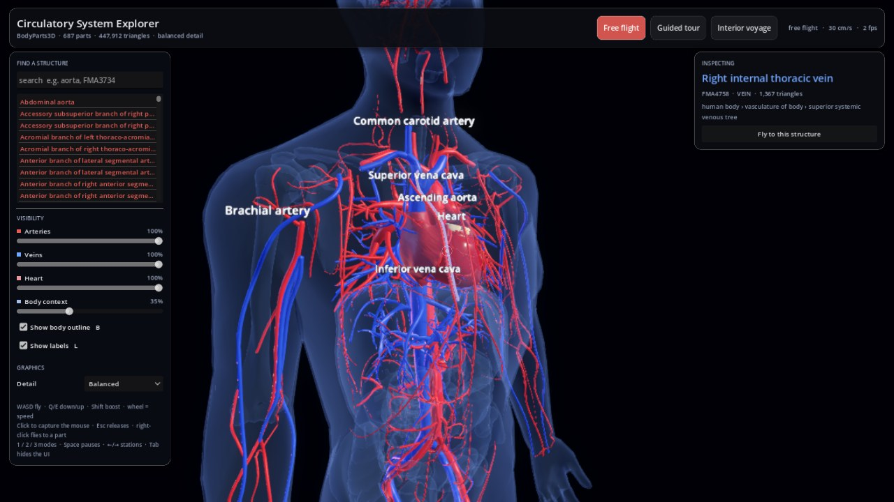
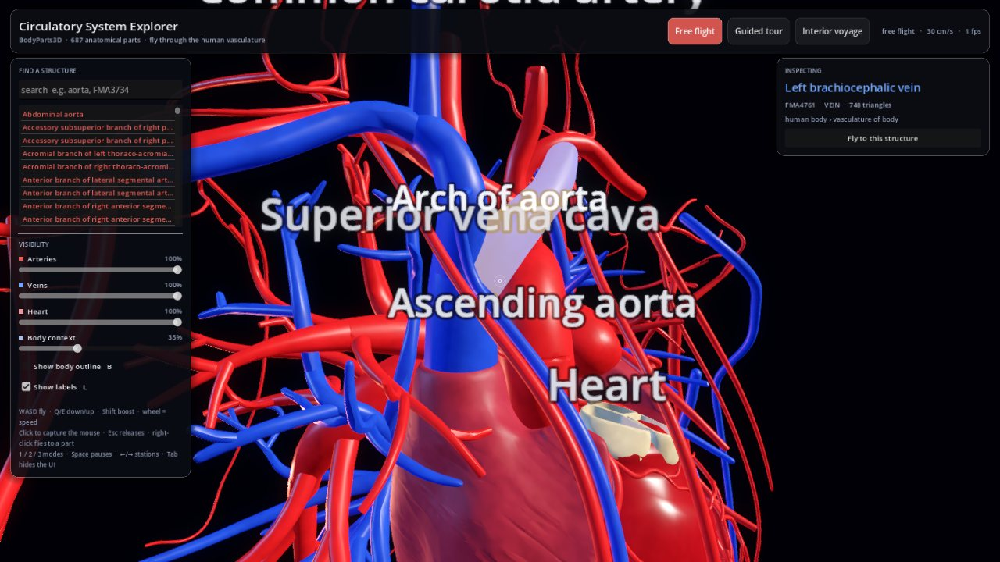

# Circulatory System Explorer

A Godot 4 app for flying through a real 3D model of the human circulatory system.
Every vessel, valve and chamber comes from **BodyParts3D** (DBCLS, Japan) — no
sculpted stand-ins, no downloaded game assets. There are three ways to move:

| Free flight | Guided tour | Interior voyage |
|---|---|---|
|  |  |  |
| 6-DOF camera, hover/click any structure to inspect it | a cinematic pass along the real blood path, with captions | the same path from inside the lumen, blood cells streaming past |




## Graphics: temporarily locked to the lowest settings

For low-end and virtual GPUs, the app always uses the **Performance** mesh set
(152,672 circulatory triangles with extra vessels hidden), Compatibility rendering by default, 50% 3D resolution, opaque
guided-tour vessels, and no glow, fog, anti-aliasing or tissue mottling. Labels
and the translucent body outline start off; they can still be turned on for
navigation. The Graphics selectors and F9 quality shortcut are disabled for
now. Previously saved quality and resolution settings are ignored but not
removed.

All modes, including the interior voyage, use the lowest-detail meshes. This
means narrow vessel interiors may look faceted or the camera may pass through a
wall; fog is also disabled. The Balanced and High datasets remain in the project
for future use, but cannot be selected while the temporary `LOWEST_ONLY` lock
in `scripts/main.gd` is enabled.

## Running it

1. Install **Godot 4.7.2** (the project declares 4.7 features; the
   standard build is fine, no C# needed).
2. Open `project.godot` in the project manager, or from a terminal:
   `godot --path .` (the app also starts without the editor's import cache —
   the glTF files are parsed at runtime in that case).
3. Press **F5** (Run Project). Running `main.tscn` directly with **F6** also
   redirects to the menu rather than loading the model.

The app opens on a **main menu without loading the anatomy model**. Choose:

- **Torso** — chest and abdomen, excluding the arms.
- **Waist down** — pelvis and lower limbs.
- **Head & neck** — vessels in the head and neck.
- **Heart** — heart structures, coronary vessels, pulmonary trunk and ascending aorta.
- **All anatomy** — the full-body model, with the guided tour and interior voyage.

Regional choices load separate, smaller Performance meshes rather than loading
and hiding the full model. The optional extra-vessel layer for the selected view
loads only when enabled or when an extra search result is selected. Use **Main
menu** at the top of the explorer to unload the view and choose another.

The regional views are approximate spatial cuts of the source model, not exact
anatomical dissections: vessels crossing a boundary are cut open and may appear
in both adjoining views. Torso uses a shoulder-width crop and excludes named
arm/shoulder vessels, so it can also trim peripheral chest branches. In these
focused views, search and picking are limited to the selected region; body
context, guided tour and interior voyage are available in **All anatomy** only.

## Low-end GPUs and virtual machines

The lowest settings are enforced automatically; use a smaller window if
needed. For a VM, enable its 3D acceleration and install the guest graphics
drivers. Some VM configurations provide only software rendering or do not
support the required graphics API.

The app defaults to the Compatibility (OpenGL) renderer. To compare it with
Forward Plus on hardware that supports Vulkan, launch:

```bash
godot --path . --rendering-method forward_plus
```

Forward Plus is an alternative to test on your hardware, not a guaranteed
speedup or fallback for unsupported virtual GPUs. Appearance and supported
effects may differ. See `tests/README.md` for repeatable benchmarks and headless tests.

## Controls

| Input | Action |
|---|---|
| `W` `A` `S` `D` | fly forward / strafe (the camera moves toward the crosshair) |
| `Q` / `E` (or `Ctrl` / `Space`) | down / up |
| `Shift` | boost ×3.5 · `Alt` slows down ×0.3 |
| mouse | look — click the window to capture the pointer, `Esc` releases it |
| mouse wheel | change cruise speed (1–400 cm/s) |
| hover | highlights the structure under the crosshair and shows its card |
| right-click | fly to the highlighted structure |
| `1` `2` `3` | free flight / guided tour / interior voyage |
| `Space` | pause · `←` `→` jump between tour stations |
| `B` | toggle the translucent body outline |
| `L` | toggle labels |
| `F9` | quality cycling disabled while lowest settings are locked |
| `Tab` | hide the whole interface |
| `R` | reset the camera |

### Gamepad

Standard Xbox-style controllers (and mapped equivalents) can be used alongside
keyboard and mouse. Button names describe the Xbox layout; on PlayStation, A/B/Y
correspond to Cross/Circle/Triangle. Stick deadzones are set to 20% and the look
rate is frame-rate independent.

| Control | Action |
|---|---|
| Left stick | Fly forward/back and strafe |
| Right stick | Look around |
| LB / RB | Fly down / up |
| LT / RT | Slow down / boost (analog) |
| A | Inspect the part under the crosshair; in a tour, pause/resume |
| B | Return to free flight or cancel an automatic flight |
| Y | Cycle free flight → guided tour → interior voyage |
| D-pad left / right | Decrease/increase flight speed; in a tour, previous/next station |
| D-pad up / down | Toggle body outline / labels |
| View / Back | Hide or show the interface |
| Menu / Start | Enter or leave interface navigation |

In interface navigation, use the D-pad and A to move between and operate
controls; press Start again to resume flight. Flight controls are disabled while
the menu is active. Pressing A during the guided-tour fly-in skips it and pauses
at the start. Keyboard and mouse remain available; switching to the controller
releases the captured mouse.

Left panel: search the selected region's circulatory parts (1,044 in All anatomy)
by name or FMA id and set the
opacity of arteries, veins, the heart and body context independently. Clicking
a search result flies the camera to it. Results marked “extra” automatically
load and show the optional extra-vessels layer when selected; the visibility
checkbox also lets you show or hide it. Loading it can take time and use more
memory and GPU resources. Hiding it removes it from view and picking, but keeps
the loaded meshes in memory until the model is reloaded. Graphics remain locked
to the lowest settings.

## What is in the scene

- **1,044 circulatory parts**: 626 arteries, 395 veins and 23 heart parts.
  This includes the coronary sinus, pulmonary trunk and ventricular wall.
  The default visible 639 circulatory parts use 152,672 triangles at
  Performance; the 405-part optional layer adds 209,035 more at Performance.
- **51 ghost context meshes** (skin, gut, kidneys, trachea, brainstem, bones…)
  — 159,510 / 82,872 / 31,866 triangles for the same three levels, drawn at
  5–35 % opacity so you can tell where you are. Toggle with `B`.
- Colour is semantic: arteries red, veins blue, myocardium/atrial wall warm red,
  valve leaflets ivory, chamber casts dark crimson (the whole set is
  oxygen-based colouring, so the pulmonary artery is drawn as an artery).

## How the model was made

`pipeline/` contains the data path. Base assets come from the PART-OF source:

```
BodyParts3D partof_BP3D_4.0_obj_99.zip   (1258 OBJ meshes, FMA part-of tree)
        │
        ├─ classify parts by anatomical name  → artery / vein / heart / other
        ├─ convert coordinates  (mm, X=left, Y=posterior, Z=superior)
        │                       → Godot (cm, Y up, −Z forward), no mirroring
        ├─ recompute area-weighted smooth vertex normals
        ├─ pack one glTF node per part          → data/circulatory.glb      (16 MB, high)
        ├─ quadric-decimate ×2 (0.45 / 0.18 of the triangles)
        │                                       → data/circulatory_lod1/2.glb (7.6 / 3.4 MB)
        ├─ quadric-decimate the ghost organs    → data/context.glb          (3 MB, high)
        │  … and the same two LOD steps        → data/context_lod1/2.glb   (1.6 / 0.7 MB)
        ├─ join FMA ids + part-of lineage       → data/parts.json
        └─ trace medial lines of 22 key vessels → data/tour.json
```

A supplemental build adds 408 structures from the BodyParts3D 4.0 **IS-A**
99%-reduced OBJ source, pinned by mirror commit and per-file hashes in
`pipeline/additional_parts.json`. The sources share a coordinate frame but not
a hierarchy: added parts have no invented PART-OF lineage. Their relationships
and surfaces can overlap the base or one another, including composite meshes;
they are not a uniquely segmented or medically complete circulation. See
`pipeline/README.md` for rebuilding both sources and the extra layer.

The tour spline deserves a note: it is not hand-drawn. For each of the 22
stations the pipeline slices the vessel mesh along its principal axis and takes
the centroid of each slice, producing a medial line that runs *inside* the
vessel. The chains are oriented so they join up, concatenated, lightly smoothed
and resampled with a Catmull-Rom spline at runtime. That is why the camera
stays in the lumen all the way from the superior vena cava to the dorsalis
pedis artery and back up the inferior vena cava.

To rebuild:

```bash
cd pipeline
python3 -m pip install numpy trimesh fast_simplification
python3 index_parts.py        # scans the OBJ headers into index.json
python3 build.py              # writes ../data/*
```

`BP3D_ROOT` points at the unzipped download (default `~/bp3d_raw`).

## Implementation notes

- **Runtime glTF loading.** `AnatomyModel` first tries the editor-imported
  PackedScene and falls back to `GLTFDocument` parsing, so the project runs
  equally well from the editor, from a fresh checkout and from an export that
  ships the raw `.glb`.
- **Cutaway sphere.** Flying *through* anatomy normally means staring at the
  inside of a wall. `shaders/vessel_*.gdshader` discard fragments within
  `hole_radius` of the camera: 6.5 cm in the guided tour, 11.5 cm around the
  heart stations (you fly inside a cleared bubble), 1.6 cm in the interior
  voyage (just enough to avoid clipping the near plane). The same shader takes a
  `mottle` weight, so the Performance preset can drop the value-noise tissue
  texture entirely.
- **Interior surfaces are darkened** in the shader when `FRONT_FACING` is false,
  so a lumen reads as a tunnel instead of a light box.
- **Picking** is AABB-prefiltered, then exact Möller–Trumbore against the mesh
  triangles (cached), choosing the nearest hit. Ghost organs and fully
  transparent buckets never block a pick; stationary views reuse the last result.
- **Blood cells** are a `MultiMesh` of ellipsoids that follow the same spline
  (420 / 240 / 110 instances for High / Balanced / Performance), and only the
  visible instances are animated. Their scale is proportional to their distance
  from the lens so they neither fill the screen nor disappear.
- **Money for the frame budget.** The temporary lowest-only policy disables glow,
  SSAO, SSIL, adjustment and fog, keeps every mode on the smallest mesh set and
  renders 3D at 50% resolution.
- **Parallel-transported up vector** for the tour camera, so the 40 cm drop down
  the femoral artery never flips the view.

## Known limits of the source data (not bugs)

- The PART-OF source lacks ventricular myocardium and many limb veins; the
  supplemental IS-A source adds a ventricular wall and many veins, but its
  coverage is still incomplete. Existing chamber casts can obscure the wall.
- The tour follows the original route, rejoining the return at the external
  iliac vein; the added meshes do not change the route or establish connections.
- The meshes are the *99 % polygon-reduced* release; up close, walls are
  visibly faceted.
- Some structures exist twice (a mirrored `…M` file for the left side). Both are
  kept so the model stays symmetric; they appear twice in the search list.

## Attribution

The anatomy is from BodyParts3D, © The Database Center for Life Science,
licensed under **CC Attribution-Share Alike 2.1 Japan**.
See `ATTRIBUTION.txt`; the licence requires attribution and share-alike if you
redistribute the models. Reference: Mitsuhashi N. *et al.*, *BodyParts3D: 3D
structure database for anatomical concepts*, Nucleic Acids Res. 2008.

The code in this repository is yours to use freely.
