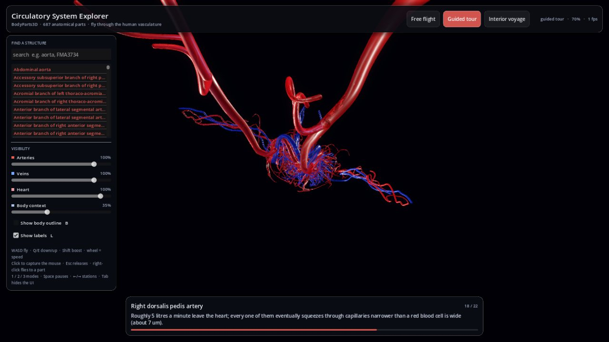

# Circulatory System Explorer

A Godot 4 app for flying through a real 3D model of the human circulatory system.
Every vessel, valve and chamber comes from **BodyParts3D** (DBCLS, Japan) — no
sculpted stand-ins, no downloaded game assets. There are three ways to move:

| Free flight | Guided tour | Interior voyage |
|---|---|---|
|  |  |  |
| 6-DOF camera, hover/click any structure to inspect it | a cinematic pass along the real blood path, with captions | the same path from inside the lumen, blood cells streaming past |


## Running it

1. Install **Godot 4.3 or newer** (developed and tested against 4.7.2; the
   standard build is fine, no C# needed).
2. Open `project.godot` in the project manager, or from a terminal:
   `godot --path .` (the app also starts without the editor's import cache —
   the glTF files are parsed at runtime in that case).
3. Press **F5**.

The first launch loads ~17 MB of glTF and builds 687 meshes; you will see
"Loading anatomy…" for a moment.

## Controls

| Input | Action |
|---|---|
| `W` `A` `S` `D` | fly forward / strafe (the camera moves toward the crosshair) |
| `Q` / `E` (or `Ctrl` / `Space`) | down / up |
| `Shift` | boost ×3.5 · `Alt` slows down ×0.3 |
| mouse | look — click the window to capture the pointer, `Esc` releases it |
| mouse wheel | change cruise speed (1–400 cm/s) |
| hover | highlights the structure under the crosshair and shows its card |
| right-click | fly to the highlighted structure |
| `1` `2` `3` | free flight / guided tour / interior voyage |
| `Space` | pause · `←` `→` jump between tour stations |
| `B` | toggle the translucent body outline |
| `L` | toggle labels |
| `Tab` | hide the whole interface |
| `R` | reset the camera |

Left panel: search all 636 circulatory parts by name or FMA id, and set the
opacity of arteries, veins, the heart and the body context independently.
Clicking a search result flies the camera to that structure.

## What is in the scene

- **636 circulatory parts**: 417 arteries, 197 veins and 22 heart parts
  (atrial walls, valve leaflets and cusps, papillary muscles, chamber casts,
  coronary vessels), 812 802 triangles.
- **51 ghost context meshes** (skin, gut, kidneys, trachea, brainstem, bones…)
  decimated to ~160 k triangles and drawn at 12–30 % opacity so you can tell
  where you are. Toggle with `B`.
- Colour is semantic: arteries red, veins blue, myocardium/atrial wall warm red,
  valve leaflets ivory, chamber casts dark crimson (the whole set is
  oxygen-based colouring, so the pulmonary artery is drawn as an artery).

## How the model was made

`pipeline/` contains the whole data path, reproducible in about 10 seconds:

```
BodyParts3D partof_BP3D_4.0_obj_99.zip   (1258 OBJ meshes, FMA part-of tree)
        │
        ├─ classify parts by anatomical name  → artery / vein / heart / other
        ├─ convert coordinates  (mm, X=left, Y=posterior, Z=superior)
        │                       → Godot (cm, Y up, −Z forward), no mirroring
        ├─ recompute area-weighted smooth vertex normals
        ├─ pack one glTF node per part          → data/circulatory.glb (16 MB)
        ├─ quadric-decimate the ghost organs    → data/context.glb      (3 MB)
        ├─ join FMA ids + part-of lineage       → data/parts.json
        └─ trace medial lines of 22 key vessels → data/tour.json
```

The tour spline deserves a note: it is not hand-drawn. For each of the 22
stations the pipeline slices the vessel mesh along its principal axis and takes
the centroid of each slice, producing a medial line that runs *inside* the
vessel. The chains are oriented so they join up, concatenated, lightly smoothed
and resampled with a Catmull-Rom spline at runtime. That is why the camera
stays in the lumen all the way from the superior vena cava to the dorsalis
pedis artery and back up the inferior vena cava.

To rebuild:

```bash
cd pipeline
python3 -m pip install numpy trimesh fast_simplification
python3 index_parts.py        # scans the OBJ headers into index.json
python3 build.py              # writes ../data/*
```

`BP3D_ROOT` points at the unzipped download (default `~/bp3d_raw`).

## Implementation notes

- **Runtime glTF loading.** `AnatomyModel` first tries the editor-imported
  PackedScene and falls back to `GLTFDocument` parsing, so the project runs
  equally well from the editor, from a fresh checkout and from an export that
  ships the raw `.glb`.
- **Cutaway sphere.** Flying *through* anatomy normally means staring at the
  inside of a wall. `shaders/vessel_*.gdshader` discard fragments within
  `hole_radius` of the camera: 9.5 cm in the guided tour (you fly inside a
  cleared bubble), 1.6 cm in the interior voyage (just enough to avoid clipping
  the near plane).
- **Interior surfaces are darkened** in the shader when `FRONT_FACING` is false,
  so a lumen reads as a tunnel instead of a light box.
- **Picking** is AABB-prefiltered, then exact Möller–Trumbore against the mesh
  triangles (cached, subsampled for huge meshes). Ghost organs never block a
  pick.
- **Blood cells** are a `MultiMesh` of 420 ellipsoids that follow the same
  spline; their scale is proportional to their distance from the lens so they
  neither fill the screen nor disappear.
- **Parallel-transported up vector** for the tour camera, so the 40 cm drop down
  the femoral artery never flips the view.

## Known limits of the source data (not bugs)

- The BodyParts3D part-of tree has **no ventricular myocardium** and no lung,
  liver or spleen meshes; the heart is made of atrial walls, valve leaflets,
  chamber casts and coronary vessels. The chamber casts are why the ventricles
  still read as solid shapes.
- Limb **veins** are not segmented (the femoral/popliteal/saphenous veins are
  absent), so the tour rejoins the venous tree at the external iliac vein. The
  caption at that station says so.
- The meshes are the *99 % polygon-reduced* release; up close, walls are
  visibly faceted.
- Some structures exist twice (a mirrored `…M` file for the left side). Both are
  kept so the model stays symmetric; they appear twice in the search list.

## Attribution

The anatomy is from BodyParts3D, © The Database Center for Life Science,
licensed under **CC Attribution-Share Alike 2.1 Japan**.
See `ATTRIBUTION.txt`; the licence requires attribution and share-alike if you
redistribute the models. Reference: Mitsuhashi N. *et al.*, *BodyParts3D: 3D
structure database for anatomical concepts*, Nucleic Acids Res. 2008.

The code in this repository is yours to use freely.
